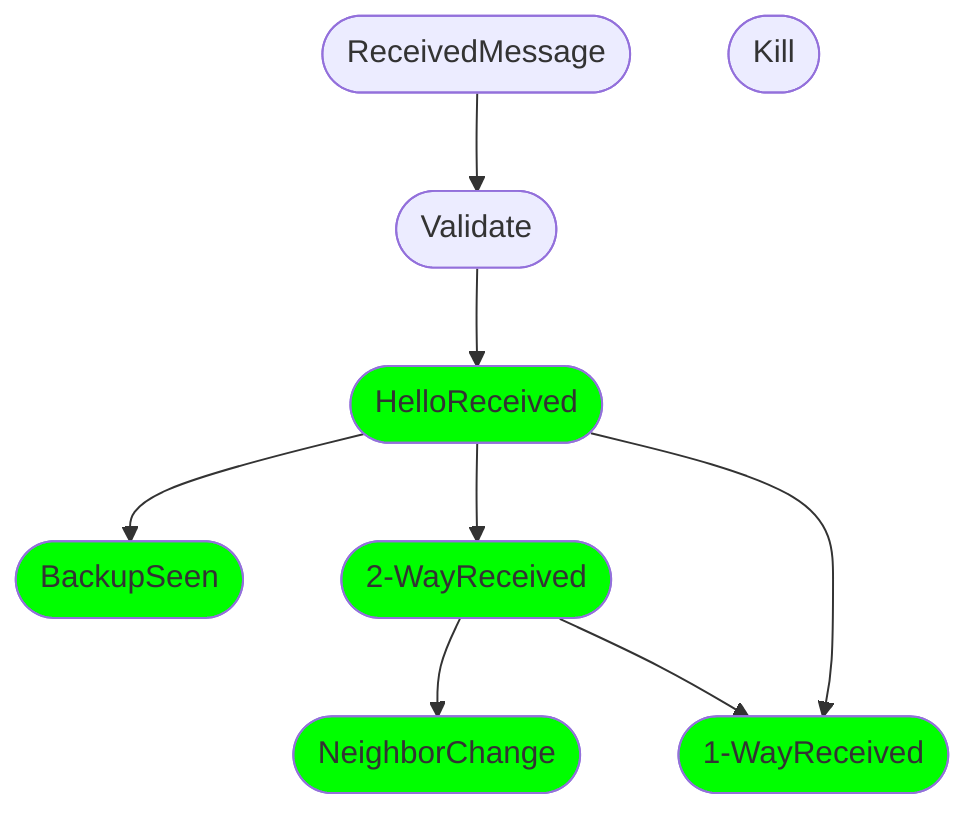
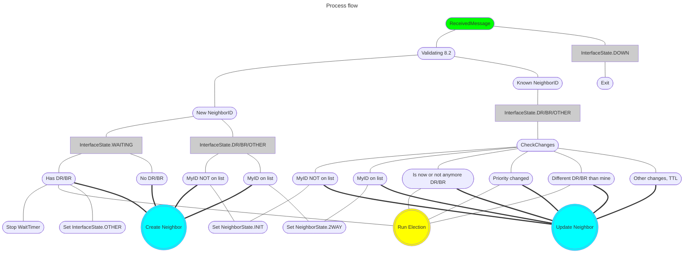

# Neighbor Manager
## Updating Neighbors based on received Hello message

## Events

## Pseudocode

    NB=neighbor whose message is processed
    ME=Receiving NetworkInterface

    Receive message

    if ME.InterfaceState.(DOWN | LOOPBACK | POINTTOPOINT):
    #Messages are not processed in these states
    #Loopback and point-to-point not included in our project
        Drop packet
        Exit

    Validate message
        IP headers:
            IP checksum
            Destination = ME.IP/ME.Destination
            IP protocol = OSPF = 89
        OSPF headers:
            Version = 2
            AreaID = ME.area_id
            IPdestination = AllDRouters #Routing related if ME is DR or BDR
            AuType = #Not included
            Authentication #Not included
            

    if MESSAGE.type == 1 #Hello
    >>> EVENT HelloReceived

        if NB.Network Mask, NB.HelloInterval, and NB.RouterDeadInterval are not same as ME...:
            drop packet
                Exit

    if ME.InterfaceState.WAITING and ((NB.id=NB.DR and NB.BDR=0) or (NB.id=NB.BDR)) :
    >>> EVENT BackupSeen	

    if (ME.id in NB.Neighbor-list):
    >>> EVENT 2-WayReceived. 

        #case NEW neighbor_ID:
        if neighbor_id not in ME.neighbors-list:
            create Neighbor instance #State is DOWN by default

        #Update that routers know each other
        if ME.NeighborState.(INIT | DOWN): 
            Set NB.NeighborState.TWOWAY

        #Priority has changed
        if NB.OLD_priority is not NB.NEW_priority:
    >>> EVENT NeighborChange

        #If neighbor was BDR or DR and says it is not anymore, or opposite
        if ((NB.OLD_DR is not NB.NEW_DR) and ((NB.OLD_DR=NB) or (NB.NEW_DR=NB))) or
        ((NB.OLD_BDR is not NB.NEW_BDR) and ((NB.OLD_BDR=NB) or (NB.NEW_BDR=NB))):
    >>> EVENT NeighborChange

        #Neighbor has differrent DR or BDR than me
        if (NB.BDR != ME.BDR) or (NB.DR != ME.DR):
    >>> EVENT NeighborChange (NOT defined in RFC)

        else (ME.id not in NB.Neighbor-list):
    >>> EVENT 1-WayReceived. 
        #Update state
        Set NeighborState.INIT
        If NB.id was ME.DR or ME.BDR:
        >>> EVENT NeighborChange (NOT defined in RFC)

        Exit #No need to process because 1ways are ignored in voting

## Process flow

