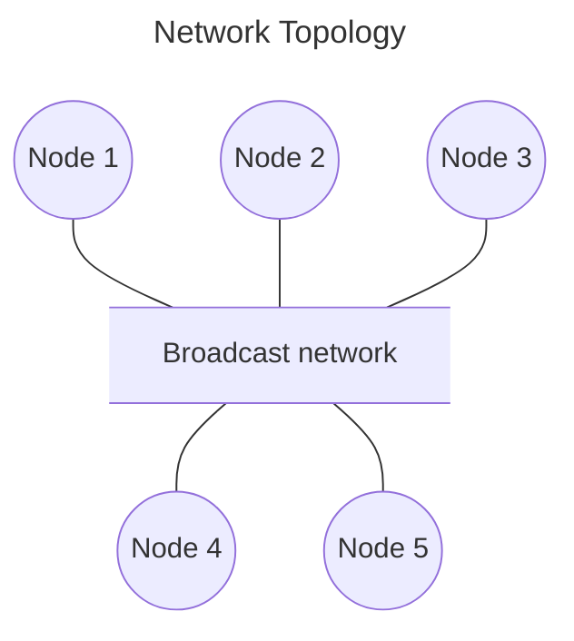
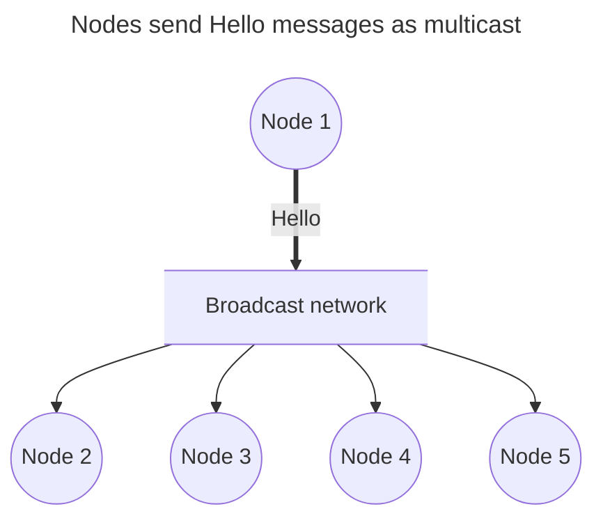
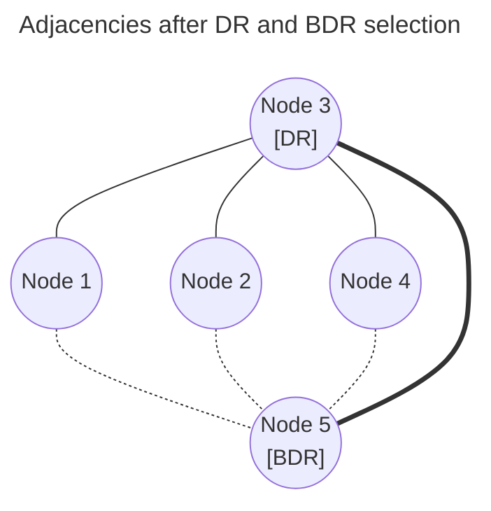

# Base Network Topologies and Node Roles

## Basic Network Architecture

The network architecture consists of similar nodes all connected to a shared multicast network.

## Hello Messages in the Network

All nodes send Hello messages as multicast messages in the network. The Hello messages are delivered to and processed by all nodes in the network. Hello messages are used to select the Designated Router (DR) and Backup Designated Router (BDR)

## Adjacencies After Designated Router and Backup Designated Router Selection

Once a Designated Router (DR) and Backup Designated Router (BDR) have been selected, both the DR and the BDR create adjacencies with all the other nodes in the network. 

_The normal lines represent adjacencies formed by the Designated Router, and the dashed lines represent adjacencies formed by the Backup Designated Router. The adjacency formed between the DR and the BDR is shown as a thick line._
