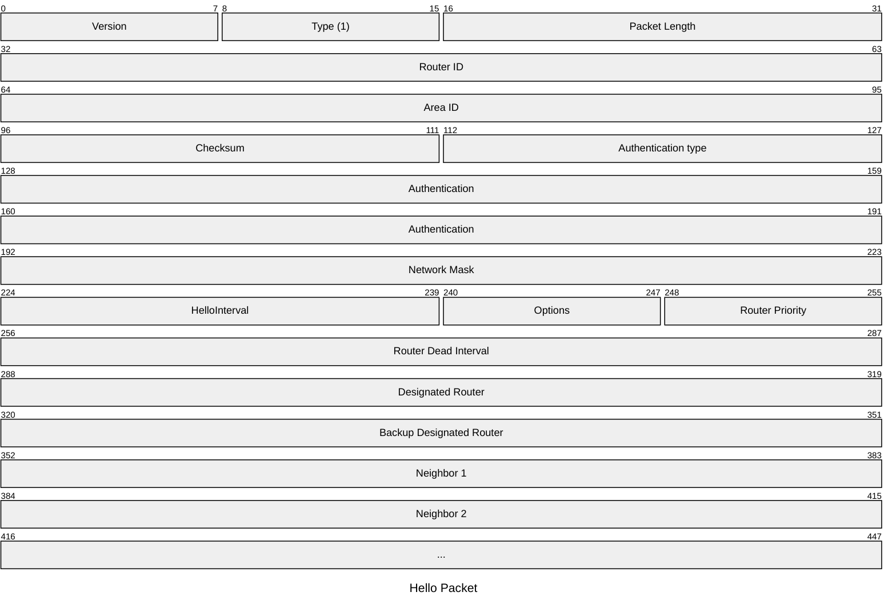

# Structure of Messages

## Hello Packet

### Fields

#### Version (1 byte)

The OSPF version number. Part of the common OSPF headers.

#### Type (1 byte)

There are 5 OSPF packet types in OSPF version 2. Hello packets are type 1. Part of the 
common OSPF headers.

#### Packet length (2 bytes)

The length of the OSPF protocol packet in bytes. Part of the common OSPF headers.

#### Router ID (4 bytes)

The Router ID of the packet's source. Part of the common OSPF headers.

#### Area ID (4 bytes)

A 32 bit number identifying the area that this packet belongs to.  All OSPF packets 
are associated with a single area.  Most travel a single hop only.  Packets 
travelling over a virtual link are labelled with the backbone Area ID of 0.0.0.0.
Part of the common OSPF headers.

#### Checksum (2 bytes)

The standard IP checksum of the entire contents of the packet, starting with the 
OSPF packet header but excluding the 64-bit authentication field.  This checksum
is calculated as the 16-bit one's complement of the one's complement sum of all
the 16-bit words in the packet, excepting the authentication field.  If the 
packet's length is not an integral number of 16-bit words, the packet is padded 
with a byte of zero before checksumming.  The checksum is considered to be part
of the packet authentication procedure; for some authentication types the
checksum calculation is omitted. Part of the common OSPF headers.

#### Authentication type (2 bytes)

Identifies the authentication procedure to be used for the packet. Out of
initial scope for this project. Part of the common OSPF headers.

#### Authentication (8 bytes)

The authentication data for this packet, actual content depends on the 
authentication type. Out of initial scope for this project.
Part of the common OSPF headers.

#### Network Mask (4 bytes)

The network mask associated with this interface.  For example, if the interface
is to a class B network whose third byte is used for subnetting, the network
mask is 0xffffff00.

#### Options (1 byte)

The optional capabilities supported by the router, as documented in Section A.2 of
RFC2328. Probably out of scope for this project.

#### Hello Interval (2 bytes)

The number of seconds between this router's Hello packets.

#### Router Priority (1 byte)

This router's Router Priority.  Used in (Backup) Designated Router election.  If
set to 0, the router will be ineligible to become (Backup) Designated Router.

#### Router Dead Interval (4 bytes)

The number of seconds before declaring a silent router down.

#### Designated Router (4 bytes)

The identity of the Designated Router for this network, in the view of the
sending router.  The Designated Router is identified here by its IP interface
address on the network.  Set to 0.0.0.0 if there is no Designated Router.

#### Backup Designated Router (4 bytes)

The identity of the Backup Designated Router for this network, in the view
of the sending router.  The Backup Designated Router is identified here by
its IP interface address on the network. Set to 0.0.0.0 if there is no
Backup Designated Router. 

#### Neighbor 1..n (4 bytes each)

The Router IDs of each router from whom valid Hello packets have been seen
recently on the network.  Recently means in the last RouterDeadInterval 
seconds.

## References

- [RFC 2328 Appendix A.3.2: The Hello Packet](https://www.rfc-editor.org/info/rfc2328/#appendix-A.3.2)
- [RFC 2328 Appendix A.3.1: The OSPF Packet Header](https://www.rfc-editor.org/info/rfc2328/#appendix-A.3.1)
