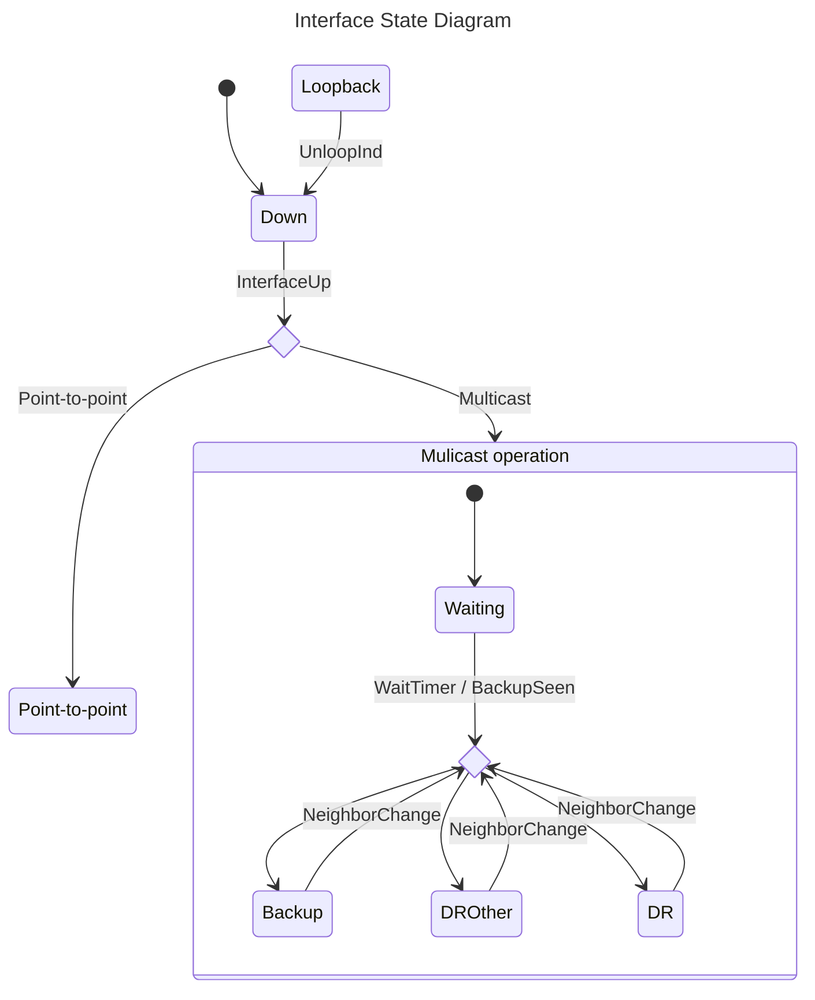
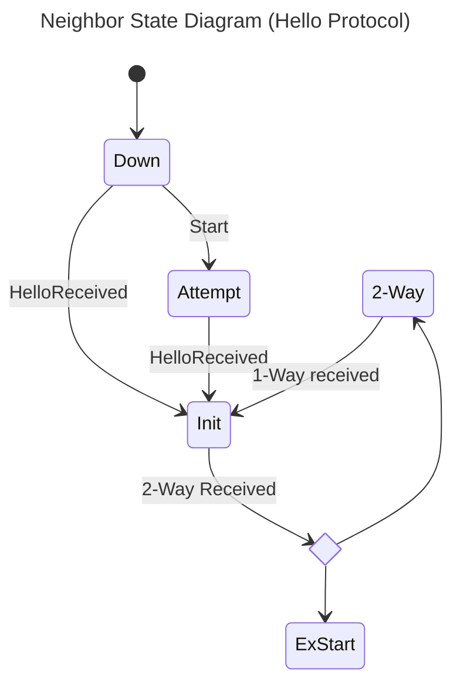
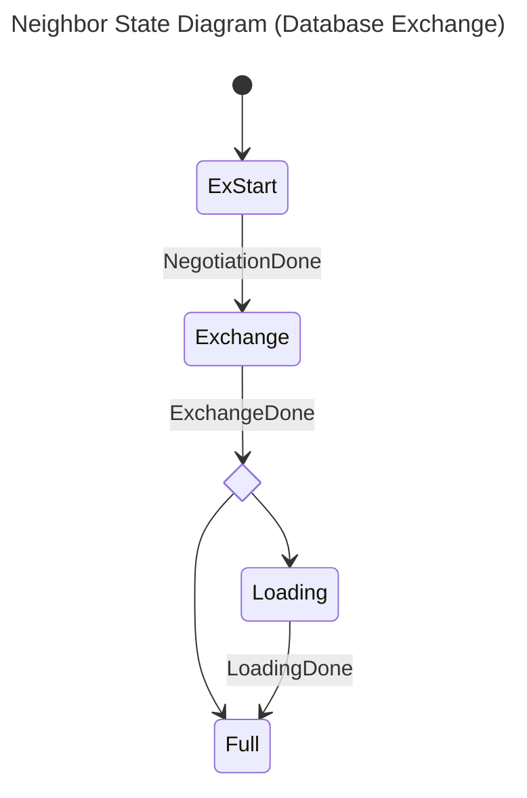

# State Diagrams Used By The Nodes

## Interface States

The state diagram describes the states a network interface can be in.

_Note: Events __InterfaceDown__ and __LoopInd__ have been omitted from the diagram for clarity. 
These events are possible in any state. Event InterfaceDown changes the interface state to Down, event 
LoopInd changes the interface state to Loopback._

### Description of Interface States

_(Paraphrased or copied from RFC2328 Section 9.1)_

#### Down

The initial interface state. Shows that the interface is currently unusable.
No protocol traffic will be sent or received on such an interface. In this state,
interface parameters should be set to their initial values. All interface timers
should be disabled, and there should be no adjacencies associated with the interface.

#### Loopback

The router's interface to the network is looped back. The interface will be unavailable for
regular data traffic.

#### Point-to-point

In this state, the interface is operational, and connects either to a physical point-to-point
network or to a virtual link. Upon entering this state, the router attempts to form
an adjacency with the neighboring router.  Hello Packets are sent to the neighbor every HelloInterval seconds.

#### Waiting

In this state, the router is trying to determine the identity of the (Backup) Designated Router
for the network. To do this, the router monitors the Hello Packets it receives.  The router is not
allowed to elect a Backup Designated Router nor a Designated Router until it transitions out of Waiting
state.  This prevents unnecessary changes of (Backup) Designated Router.

#### DR Other

The interface is to a broadcast or NBMA network on which another router has been selected to be
the Designated Router.  In this state, the router itself has not been selected Backup Designated Router
either.  The router forms adjacencies to both the Designated Router and the Backup Designated Router
(if they exist).

#### Backup

In this state, the router itself is the Backup Designated Router on the attached network.
It will be promoted to Designated Router when the present Designated Router fails. The router 
establishes adjacencies to all other routers attached to the network.  The Backup Designated 
performs slightly different functions during the Flooding Procedure, as compared to the
Designated Router (see RFC2328 Section 13.3).  

See RFC2328 Section 7.4 for more details on the functions performed by the Backup Designated Router.

#### DR

In this state, this router itself is the Designated Router on the attached network.
Adjacencies are established to all other routers attached to the network.  The router must originate
a network-LSA for the network node.  The network-LSA will contain links to all routers (including the
Designated Router itself) attached to the network.  See RFC2328 Section 7.3 for more details on the
functions performed by the Designated Router.

### Events Causing Interface State Changes

#### InterfaceUp

Lower-level protocols have indicated that the network interface is operational.  This enables the
interface to transition out of Down state. _(In our case we bring the interface up when a socket has been successfully bound, --Antti)_

#### WaitTimer

The Wait Timer has fired, indicating the end of the waiting period that is required before 
electing a (Backup) Designated Router.

#### BackupSeen

The router has detected the existence or non-existence of a Backup Designated Router for the
network.  This is done in one of two ways.  First, an Hello Packet may be received from a neighbor
claiming to be itself the Backup Designated Router.  Alternatively, an Hello Packet may be
received from a neighbor claiming to be itself the Designated Router, and indicating that there
is no Backup Designated Router.  In either case there must be bidirectional communication with
the neighbor, i.e., the router must also appear in the neighbor's Hello Packet.  This event signals
an end to the Waiting state.

#### NeighborChange

There has been a change in the set of bidirectional neighbors associated with the interface.
The (Backup) Designated Router needs to be recalculated.  The following neighbor changes lead
to the NeighborChange event.  For an explanation of neighbor states, see RFC2328 Section 10.1.

- Bidirectional communication has been established to  neighbor.  In other words, the state
of the neighbor has transitioned to 2-Way or higher.
- There is no longer bidirectional communication with a neighbor.  In other words, the state
of the neighbor has transitioned to Init or lower.
- One of the bidirectional neighbors is newly declaring itself as either Designated Router or
Backup Designated Router.  This is detected through examination of that neighbor's Hello Packets.
- One of the bidirectional neighbors is no longer declaring itself as Designated Router, or
is no longer declaring itself as Backup Designated Router.  This is again detected through
examination of that neighbor's Hello Packets.
- The advertised Router Priority for a bidirectional neighbor has changed.  This is again
detected through examination of that neighbor's Hello Packets.

#### LoopInd

An indication has been received that the interface is now looped back to itself.  This
indication can be received either from network management or from the lower level protocols.

#### UnloopInd

An indication has been received that the interface is no longer looped back.  As with the
LoopInd event, this indication can be received either from network management or from the 
lower level protocols.

#### InterfaceDown

Lower-level protocols indicate that this interface is no longer functional.  No matter 
what the current interface state is, the new interface state will be Down.

### Detailed Description of State Changes

#### State: Down

> ##### Event: InterfaceUp
>
> **New State:** Depends upon action routine
>
> **Action:** Start the interval **Hello Timer**, enabling the periodic sending of Hello
> packets out of the interface. If the attached network is a physical point-to-point
> network, Point-to-MultiPoint network or virtual link, the interface state transitions
> to **Point-to-Point**. Else, if the Router is _not eligible_ to become Designated
> Router the interface transitions to **DR Other**.
>
> Otherwise, the attached network is a broadcast or NBMA network and the router is
> eligible to become Designated Router.  In this case, in an attempt to discover the
> attached network's Designated Router the interface state is set to **Waiting** and the
> single shot **Wait Timer** is started.  Additionally, if the network is an NBMA network
> examine the configured list of neighbors for this interface and generate the
> neighbor event Start for each neighbor that is also eligible to become Designated
> Router.

#### State: Waiting

> ##### Event: BackupSeen
>
> **New State:** Depends upon action routine
>
> **Action:** Calculate the attached network's Backup Designated Router and
> Designated Router, as shown in RFC2328 Section 9.4.  As a result of this
> calculation, the new state of the interface will be either **DR Other**, **Backup**
> or **DR**.

> ##### Event: WaitTimer
> 
> **New State:** Depends upon action routine
>
> **Action:** Calculate the attached network's Backup Designated Router and
> Designated Router, as shown in RFC2328 Section 9.4.  As a result of this
> calculation, the new state of the interface will be either **DR Other**, **Backup**
> or **DR**.

#### State: DR Other, Backup or DR

> ##### Event: NeighborChange
>
> **New State:** Depends upon action routine
>
> **Action:** Recalculate the attached network's Backup Designated Router and
> Designated Router, as shown in RFC2328 Section 9.4.  As a result of this
> calculation, the new state of the interface will be either **DR Other**, **Backup**
> or **DR**.

#### State: Any state

> ##### Event: InterfaceDown
>
> **New State:** Down
>
> **Action:** All interface variables are reset, and interface timers disabled.
> Also, all neighbor connections associated with the interface are destroyed.
> This is done by generating the event KillNbr on all associated neighbors (see
> RFC2328 Section 10.2).

> ##### Event: LoopInd
> 
> **New State:** Loopback
>
> **Action:** Since this interface is no longer connected to the attached network
> the actions associated with the above **InterfaceDown** event are executed.

#### State: Loopback

> ##### Event: UnloopInd
>
> **New State:** Down
>
> **Action:** No actions are necessary.  For example, the interface variables have
> already been reset upon entering the **Loopback** state. Note that reception of an
> InterfaceUp event is necessary before the interface again becomes fully functional.

## Neighbor States

The diagram describes the states a neighbor (or the state of a conversation being
held with a neighboring router) can have and their transitions. The states are 
considered to be ordered according to progressive functionality. When documentation
refers to a neighbor's state being "greater than" or "less than" something, refer to
the order the events are listed in the section **Descriptions of Neighbor States**.

_In addition to the state transitions pictured, Event KillNbr always forces Down
State, Event InactivityTimer always forces Down State, Event LLDown always forces
Down State_

Additionally, the **ExStart** state leads to the Neighbor States of the database
exchange process performed when neighbors count as adjacent. _(Note that this means
a neighbor is considered adjacent when it's state is one of the states shown in the
diagram below. --Antti)_

_In addition to the state transitions pictured,_
- _Event SeqNumberMismatch forces ExStart state,_
- _Event BadLSReq forces ExStart state,_
- _Event 1-Way forces Init state,_
- _Event KillNbr always forces Down State,_
- _Event InactivityTimer always forces Down State,_
- _Event LLDown always forces Down State,_
- _Event AdjOK? leads to adjacency forming/breaking_
  
### Descriptions of Neighbor States

_(Paraphrased or copied from RFC2328 Section 9.1)_

#### Down

This is the initial state of a neighbor conversation.  It indicates that there has
been no recent information received from the neighbor.  On NBMA networks, Hello 
packets may still be sent to "Down" neighbors, although at a reduced frequency (see 
RFC2328 Section 9.5.1).

#### Attempt

This state is only valid for neighbors attached to NBMA networks.  It indicates that
no recent information has been received from the neighbor, but that a more concerted 
effort should be made to contact the neighbor.  This is done by sending the neighbor 
Hello packets at intervals of HelloInterval (see RFC2328 Section 9.5.1).

#### Init

In this state, an Hello packet has recently been seen from the neighbor.  However,
bidirectional communication has not yet been established with the neighbor (i.e., the
router itself did not appear in the neighbor's Hello packet).  All neighbors in this 
state (or higher) are listed in the Hello packets sent from the associated interface.

#### 2-Way

In this state, communication between the two routers is bidirectional.  This has been
assured by the operation of the Hello Protocol.  This is the most advanced state short
of beginning adjacency establishment.  The (Backup) Designated Router is selected from
the set of neighbors in state 2-Way or greater. 

#### ExStart

This is the first step in creating an adjacency between the two neighboring routers.
The goal of this step is to decide which router is the master, and to decide upon the 
initial DD sequence number.  Neighbor conversations in this state or greater are called
adjacencies.

#### Exchange

In this state the router is describing its entire link state database by sending
Database Description packets to the neighbor.  Each Database Description Packet has a
DD sequence number, and is explicitly acknowledged.  Only one Database Description 
Packet is allowed outstanding at any one time.  In this state, Link State Request
Packets may also be sent asking for the neighbor's more recent LSAs. All adjacencies
in Exchange state or greater are used by the flooding procedure.  In fact, these a
djacencies are fully capable of transmitting and receiving all types of OSPF 
routing protocol packets.

#### Loading

In this state, Link State Request packets are sent to the neighbor asking for the 
more recent LSAs that have been discovered (but not yet received) in the Exchange 
state.

#### Full

In this state, the neighboring routers are fully adjacent. These adjacencies 
will now appear in router-LSAs and network-LSAs.

