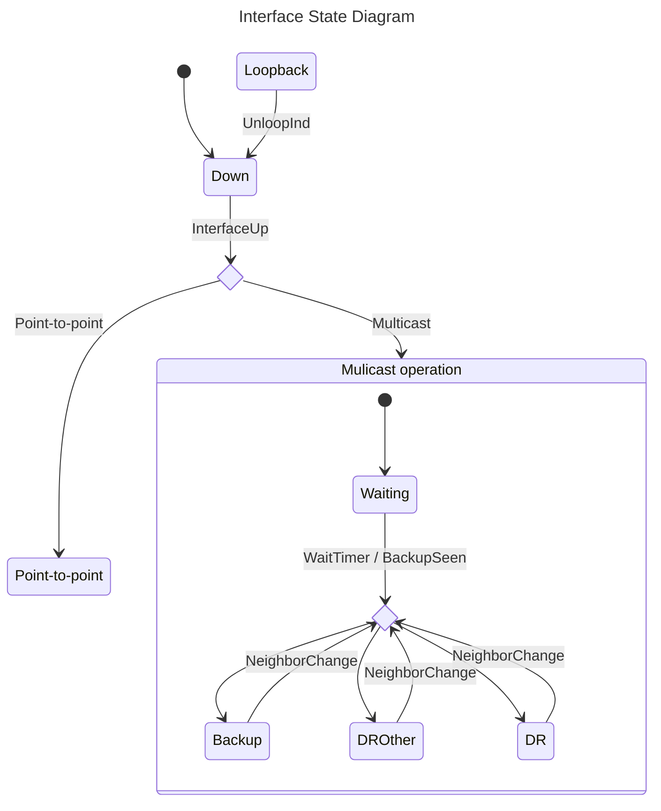

# State Diagrams Used By The Nodes

## Interface State Diagram

The state diagram describes the states a network interface can be in.

_Note: Events __InterfaceDown__ and __LoopInd__ have been omitted from the diagram for clarity. 
These events are possible in any state. Event InterfaceDown changes the interface state to Down, event 
LoopInd changes the interface state to Loopback._

### Description of Interface States

_(Paraphrased or copied from RFC2328 Section 9.1)_

#### Down

The initial interface state. Shows that the interface is currently unusable.
No protocol traffic will be sent or received on such an interface. In this state,
interface parameters should be set to their initial values. All interface timers
should be disabled, and there should be no adjacencies associated with the interface.

#### Loopback

The router's interface to the network is looped back. The interface will be unavailable for
regular data traffic.

#### Point-to-point

In this state, the interface is operational, and connects either to a physical point-to-point
network or to a virtual link. Upon entering this state, the router attempts to form
an adjacency with the neighboring router.  Hello Packets are sent to the neighbor every HelloInterval seconds.

#### Waiting

In this state, the router is trying to determine the identity of the (Backup) Designated Router
for the network. To do this, the router monitors the Hello Packets it receives.  The router is not
allowed to elect a Backup Designated Router nor a Designated Router until it transitions out of Waiting
state.  This prevents unnecessary changes of (Backup) Designated Router.

#### DR Other

The interface is to a broadcast or NBMA network on which another router has been selected to be
the Designated Router.  In this state, the router itself has not been selected Backup Designated Router
either.  The router forms adjacencies to both the Designated Router and the Backup Designated Router
(if they exist).

#### Backup

In this state, the router itself is the Backup Designated Router on the attached network.
It will be promoted to Designated Router when the present Designated Router fails. The router 
establishes adjacencies to all other routers attached to the network.  The Backup Designated 
performs slightly different functions during the Flooding Procedure, as compared to the
Designated Router (see RFC2328 Section 13.3).  

See RFC2328 Section 7.4 for more details on the functions performed by the Backup Designated Router.

#### DR

In this state, this router itself is the Designated Router on the attached network.
Adjacencies are established to all other routers attached to the network.  The router must originate
a network-LSA for the network node.  The network-LSA will contain links to all routers (including the
Designated Router itself) attached to the network.  See RFC2328 Section 7.3 for more details on the
functions performed by the Designated Router.

